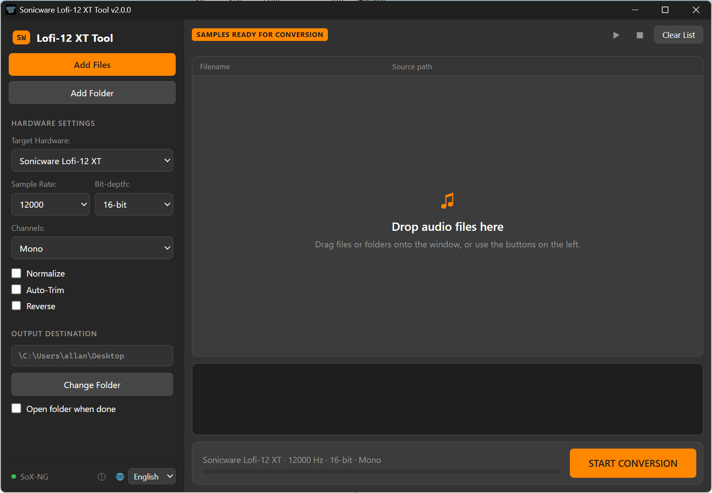

# Sonicware Lofi-12 XT Tool v2.0.0

A high-speed batch audio converter specifically designed for hardware samplers like the Sonicware Lofi-12 XT. Powered by the legendary SoX (Sound eXchange) engine for maximum precision and performance.

Version 2.0 is a complete rewrite in Electron (Node.js) with a new layout: all hardware settings and the output folder are in the sidebar, and the main window has the file list, a waveform preview and a convert bar with a progress bar. The window can be resized, and the grey and orange colors are the same as before.



## 🚀 Features

- **Batch processing:** Drag and drop multiple files or entire folders (WAV, MP3, FLAC, OGG, WMA, M4A).
- **Hardware profiles:** One-click presets for:

  | Device | Sample rate | Bit depth | Channels |
  | --- | --- | --- | --- |
  | Sonicware Lofi-12 XT | 24 kHz | 16-bit | Mono |
  | Sonicware Lofi-12 (Original) | 12 kHz | 16-bit | Mono |
  | Elektron Digitakt (Mk1) | 44.1 kHz | 16-bit | Mono |

  You can also pick sample rate (12/24/44.1/48 kHz), bit depth (16/24-bit) and channels (mono/stereo) by hand.
- **Smart filenames:** Replaces spaces and invalid characters with underscores and never overwrites existing files (a numbered suffix is added instead).
- **Normalize:** Peak normalization to 0 dB for consistent volume across all your samples.
- **Auto-Trim:** Removes silence at the start and end of each sample.
- **Reverse:** Reverses samples during conversion (output files get a `_rev` suffix).
- **Preview:** Click a file to play it and see its waveform (WAV, MP3, FLAC, OGG and M4A; WMA can be converted but not previewed).
- **Blazing fast:** Uses the SoX engine and converts in the background, so the window stays responsive.
- **Clear errors:** Converted files get a ✓ and files that fail are highlighted in the list; hover over one to see the SoX error message.
- **SoX status:** The bottom of the sidebar shows whether SoX or SoX-NG was found; hover over it to see the path.
- **Multilingual:** English, Danish, German, Spanish, French, Italian and Swedish (switch with the language picker at the bottom of the sidebar).
- **Open source:** Free to use, modify, and distribute.

Output is always WAV.

## 🛠 Installation

1. **Download the tool:** Get the latest release from the [Releases](https://github.com/tristan202/sonicwaretool/releases) page:
   - `SonicwareTool Setup x.y.z.exe` installs the tool for your user (no admin rights needed) with a Start menu and desktop shortcut. It can be removed again from Windows Settings > Apps.
   - `SonicwareTool-x.y.z-portable.exe` runs without installing.
2. **Get SoX:** The tool requires `sox.exe` ([SoX](https://sourceforge.net/projects/sox/)) or `sox_ng.exe` ([SoX-NG](https://codeberg.org/sox_ng/sox_ng)). The tool looks for it in this order:
   - the same folder as the tool (place `sox.exe` / `sox_ng.exe` and its `.dll` files there; for the installed version that is `%LOCALAPPDATA%\Programs\SonicwareTool`),
   - `C:\Program Files (x86)\sox-14-4-2\`,
   - any folder on your `PATH`.

   If SoX can't be found, the tool asks you to locate it the first time you press **START CONVERSION**. MP3 and other compressed formats require a SoX build with support for those formats.
3. **Run:** Open the tool and you are ready to go.

Settings are stored in `%APPDATA%\SonicwareTool\settings.json` (settings from v1.x are imported automatically). Converted files go to `Documents\XT_Export` by default.

## 📖 How to Use

1. **Add files:** Drag and drop audio files or folders into the list, or use the **Add Files** / **Add Folder** buttons. Adding a folder doesn't include its subfolders.
2. **Set output:** Choose where you want your converted samples to be saved with **Change Folder**.
3. **Adjust settings:** Pick a target hardware profile, or select sample rate, bit depth and channels yourself. Enable **Normalize**, **Auto-Trim** or **Reverse** as needed.
4. **Convert:** Hit **START CONVERSION**. Progress is shown below the settings, along with the number of failed files, if any. Enable **Open folder when done** to have the output folder open automatically.

## 🧑‍💻 Building from Source

You need [Node.js](https://nodejs.org/) 20 or newer.

```bash
npm install
```

Run the app (it finds `sox.exe` / `sox_ng.exe` in the project folder, or on your `PATH`):

```bash
npm start
```

Run the tests (the conversion test is skipped if SoX isn't found):

```bash
npm test
```

Build the Windows installer into `dist/`:

```bash
npm run dist
```

Build the portable `.exe` instead (or `npm run dist:all` for both):

```bash
npm run dist:portable
```

The app uses Electron, so it can in principle run on macOS and Linux with `sox` installed from your package manager, but only Windows has been tested.

The original PureBasic version (v1.x) is still available in the git history and in the v1.0.0 release.

## 📜 License

This project is licensed under the [GNU General Public License v3.0](LICENSE).

You are free to use, study, modify and distribute this software, including commercially. If you distribute it or a modified version, you must make the source code available under the same license.

## 👤 Credits

Created by [tristan202](https://github.com/tristan202).

Special thanks to the Sonicware community for inspiration.
